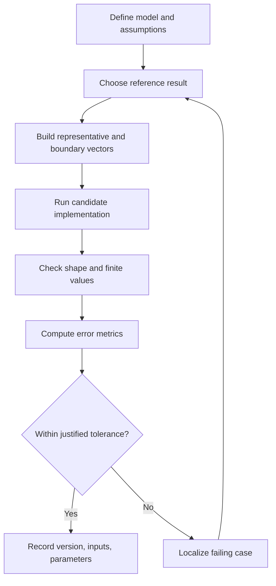

# Numerical Methods and Algorithm Validation

Numerical results depend on assumptions, conditioning, discretization, and floating-point error. A plausible plot alone does not prove an algorithm is correct.

## 1. Linear systems and conditioning

For (A x = b), compute the solution with `A\\b` and inspect the residual:

```matlab
A = [4 1; 1 3];
b = [1; 2];
x = A \ b;
r = A*x - b;
fprintf("Residual norm = %.3g\n", norm(r));
fprintf("Condition estimate = %.3g\n", cond(A));
```

A small residual is useful but does not guarantee a small solution error when the matrix is ill-conditioned. Consider the problem scale and input uncertainty.

## 2. Interpolation and extrapolation

Linear interpolation estimates values between adjacent samples. The sample coordinates should be ordered and duplicate coordinates need an explicit policy.

```matlab
x = [0 1 2 3];
y = [0 10 20 30];
xq = [0.5 1.5 2.5];
yq = interp1(x, y, xq, 'linear');
```

Do not silently extrapolate unless it is physically justified. Compare a custom implementation against a trusted reference over endpoints, interior points, vector orientations, and invalid tables. See [checked interpolation](../Src/Examples/linear_interp_checked.m).

## 3. Curve fitting

A fitted curve describes the chosen model and data; it does not prove causation or guarantee behavior outside the measured range. Split data or use independent validation when assessing generalization. Inspect residuals for structure rather than reporting only a goodness-of-fit score.

## 4. Filtering

Filtering trades noise reduction against response delay and distortion. Before choosing a filter, define sampling frequency, passband, expected noise, latency limits, and startup behavior. Test step inputs, constant inputs, impulses, and representative recorded signals.

## 5. Error metrics

For a reference vector (r) and candidate (y):

```matlab
e = y - r;
mae = mean(abs(e));
rmse = sqrt(mean(e.^2));
maxError = max(abs(e));
```

Ensure `y` and `r` have matching sizes and aligned samples. State units and tolerances. For empty or non-finite inputs, define a deliberate policy rather than accepting meaningless metrics.

## 6. Algorithm verification loop



## Practice lab

1. Solve a well-conditioned and an ill-conditioned linear system; compare residual and condition number.
2. Compare built-in interpolation with the repository's checked interpolation helper.
3. Test a filter with a constant input, step input, and noisy sine wave.
4. Record MAE, RMSE, maximum error, and the reason for the acceptance tolerance.

## Related pages

- [Interpolation example](../Src/Examples/linear_interp_checked.m)
- [Low-pass filter example](../Src/Examples/lowpass_filter.m)
- [Reference output comparison](../Src/Examples/compare_reference_outputs.m)
- [Fixed-point comparison](../Src/Examples/compare_fixed_point.m)
