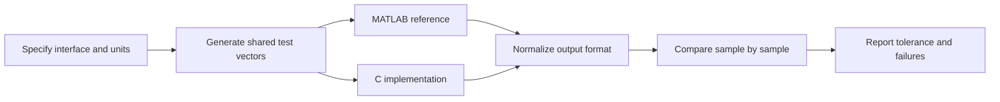

# MATLAB Engineering Project Portfolio

Complete projects in increasing complexity. Each project should include a short README, reproducible inputs, implementation, tests, and a result report.

## Project 1 — Sensor data exploration

**Goal:** turn raw samples into an interpretable report.

Deliverables:
- Input schema and units.
- Missing/non-finite-value report.
- Raw and processed plots.
- Mean, median, standard deviation, minimum, and maximum.
- A written explanation of every cleaning rule.

Acceptance checks: input file absence is handled clearly; raw data is preserved; all plotted axes have units.

## Project 2 — Checked interpolation utility

**Goal:** implement a reusable piecewise-linear interpolation function.

Requirements:
- Equal-length sample arrays.
- Strictly increasing sample coordinates.
- Support row and column query vectors or document a narrower contract.
- Explicit out-of-range behavior.
- Tests for endpoints, interior values, duplicate coordinates, empty inputs, and invalid values.

Reference: [linear_interp_checked.m](../Src/Examples/linear_interp_checked.m).

## Project 3 — Low-pass filter comparison

**Goal:** evaluate smoothing versus delay.

Experiments:
- Constant signal and step response.
- Sine wave plus deterministic noise.
- Several `alpha` values.
- Startup initialization comparison.
- Runtime and output error measurement.

Reference: [lowpass_filter.m](../Src/Examples/lowpass_filter.m).

## Project 4 — Position/velocity Kalman estimator

**Goal:** estimate a moving object's position and velocity from noisy position observations.

Deliverables:
- State transition and observation matrices.
- Initial state and covariance.
- Process/measurement noise assumptions.
- Estimated position and velocity plots.
- Error analysis against synthetic ground truth.
- Tests for invalid dimensions and short sequences.

Reference: [kalman_position_velocity.m](../Src/Examples/kalman_position_velocity.m).

## Project 5 — Fixed-point implementation study

**Goal:** understand the difference between floating-point and fixed-width arithmetic.

Deliverables:
- Numeric format and scale factor.
- Rounding policy and saturation bounds.
- Overflow test vectors.
- MAE, RMSE, maximum absolute error, and saturation count.
- Explanation of errors that would be unacceptable in the target application.

Reference: [compare_fixed_point.m](../Src/Examples/compare_fixed_point.m).

## Project 6 — MATLAB/C cross-validation

**Goal:** use MATLAB as a reference model for a small C implementation.

Requirements:
- Same input vectors and parameters.
- Compiler warnings enabled for C.
- Explicit type conversions and overflow policy.
- Automated regression tests.
- Failure output identifies the first mismatching sample.

Reference: [Examples README](../Src/Examples/README.md).

## Project 7 — Reproducible algorithm package

Package one algorithm as if another engineer must maintain it:
- Clear function contract and examples.
- Input validation and informative errors.
- Automated tests including regressions.
- Dependency and version statement.
- README with one-command reproduction steps.
- A changelog entry when behavior changes.

## Definition of done

A project is complete when a new user can clone the repository, follow the documented instructions, reproduce the results, understand the assumptions, and run the tests without relying on hidden workspace state.
