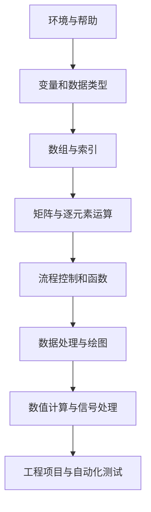

# MATLAB 基础教程

> 本文保留仓库中的原始教程内容，并补充系统学习导航。建议按顺序阅读 [环境与工作流](00-Environment-and-Workflow.md)、[语言基础](01-Language-Fundamentals.md)、[数组与矩阵](02-Arrays-Matrices.md)、[函数与测试](03-Functions-and-Testing.md)、[数据分析与可视化](04-Data-and-Visualization.md)、[数值方法](05-Numerical-Methods.md)、[信号处理与嵌入式算法](06-Signal-Control-and-Embedded.md)，再完成 [工程项目集](07-Project-Portfolio.md) 和 [实践练习](../Questions/MATLAB-Practice-Labs.md)。原始章节继续保留，便于与新增教程对照。

## 学习导航

| 阶段 | 核心内容 | 建议动作 |
|---|---|---|
| 环境与帮助 | 命令窗口、工作区、路径、help/doc | 学会定位函数、检查版本与依赖 |
| 语言基础 | 变量、数据类型、运算符、流程控制 | 每个语法点写一个最小示例 |
| 数组与矩阵 | 索引、矩阵运算、逻辑索引、预分配 | 重点区分矩阵运算与逐元素运算 |
| 函数与调试 | 输入输出、作用域、断点、异常处理 | 把重复逻辑封装为函数并测试 |
| 数据与绘图 | 导入、统计、曲线、子图、图形导出 | 保留原始数据并标注单位 |
| 数值与工程 | 线性方程、FFT、滤波、算法验证 | 使用固定测试向量和误差指标 |

## 推荐学习顺序



## 最小运行练习

将下面代码保存为脚本并运行，确认变量、数组运算和绘图流程都能正常工作：

```matlab
clear; clc; close all;

Fs = 1000;
t = (0:999) / Fs;
x = sin(2*pi*5*t) + 0.1*cos(2*pi*40*t);

figure;
plot(t, x);
grid on;
xlabel('Time (s)');
ylabel('Amplitude');
title('Sample signal');
```

练习要求：
1. 把 5 Hz 与 40 Hz 改成其他频率，观察波形变化。
2. 修改采样率和采样点数，确认时间轴与数据长度一致。
3. 使用 `mean`、`max`、`min` 计算统计量。
4. 为脚本添加输入参数检查，并把信号生成逻辑改写成函数。

## 学习检查

- [ ] 能解释 `A*B` 与 `A.*B` 的区别。
- [ ] 能使用索引和逻辑掩码筛选数组。
- [ ] 能将脚本中的重复逻辑封装成函数。
- [ ] 能导入数据、绘制带单位的图并保存结果。
- [ ] 能为算法设计边界测试并计算误差。
- [ ] 能说明示例依赖的 MATLAB 版本或工具箱。

## 配套资料

- [MATLAB 基础 100 问](../Questions/Matlab-Basics-100.md)：概念、示例、边界条件与工程验证。
- [学习路线与实践计划](../StudyPlan.md)：阶段目标、项目练习和复盘方式。
- [函数参考](../Src/Function.md)：查找已有的常用函数记录。

> Version  MATLAB2018b 


---


# 目录
* [1.MATLAB用户界面](#1.MATLAB用户界面)
* [2.帮助系统](#2.帮助系统)
* [3.MATLAB基础知识](#3.MATLAB基础知识)
* [4.向量与多项式子](#4.向量与多项式子)
* [5.矩阵运算](#5.矩阵运算)
* [6.二维绘图](#6.二维绘图)

---


# 1.MATLAB用户界面

## 1.1 MATLAB中的科学计算概述

MATLAB 是面向矩阵与数组计算的交互式环境，常用于数值分析、数据处理、可视化、算法原型、控制系统与信号处理。它的优势不只是命令短，而是可以将数据导入、算法计算、图形展示和自动化验证放在同一工作流中。

典型工作流：


## 1.2 桌面主要区域

| 区域 | 用途 | 常见操作 |
|---|---|---|
| 命令窗口 | 执行即时命令 | 试算、查询、快速诊断 |
| 编辑器 | 编写脚本和函数 | 保存为 `.m` 文件并运行 |
| 工作区 | 查看当前变量 | 检查变量名、类型和尺寸 |
| 当前文件夹 | 浏览工程文件 | 管理输入、脚本与输出 |
| 图形窗口 | 查看可视化结果 | 添加标注、导出图像 |

建议把探索性命令留在命令窗口，把可复现步骤保存到脚本，把重复算法封装为函数。

# 2.帮助系统

MATLAB 帮助系统用于确认函数语法、输入类型、输出形式、示例和版本限制。不要只凭函数名猜测参数顺序。

```matlab
help mean             % 命令窗口中的简要说明
doc mean              % 打开完整帮助页面
which mean -all       % 查看实际解析到的实现
lookfor interpolation % 按关键词搜索函数
version               % MATLAB 版本
ver                   % 已安装产品和工具箱
```

排查“函数无法识别”时，依次确认拼写、大小写、文件路径、函数所属工具箱和版本支持。使用 `which functionName -all` 检查是否有同名文件遮蔽内置函数。

# 3.MATLAB基础知识

## 3.1 MATLAB命令的组成

### 3.1.1 基本符号

| 符号 | 含义 | 示例 |
|---|---|---|
| `=` | 赋值 | `x = 3` |
| `;` | 抑制命令窗口输出；矩阵中也用于分行 | `x = 3;`、`[1 2; 3 4]` |
| `%` | 单行注释 | `% calculate mean` |
| `...` | 将语句延续到下一行 | `y = longFunction( ...` |
| `:` | 生成序列、选择范围或整行/列 | `1:2:9`、`A(:,1)` |
| `()` | 函数调用或数组索引 | `mean(x)`、`A(2,1)` |
| `[]` | 创建或拼接数组 | `[1 2 3]` |
| `{}` | 创建元胞数组或访问元胞内容 | `C{1}` |
| `.` | 结构体字段或逐元素运算符的一部分 | `s.value`、`A.*B` |

### 3.1.2 功能符号

| 运算 | 矩阵/标量运算 | 逐元素运算 |
|---|---|---|
| 乘法 | `A * B` | `A .* B` |
| 除法 | `A / B`、`A \\ B` | `A ./ B`、`A .\\ B` |
| 幂 | `A ^ n` | `A .^ n` |

矩阵运算受线性代数维度规则约束；逐元素运算要求数组尺寸兼容。复数矩阵转置时，`A'` 会共轭，`A.'` 只交换维度。务必根据数学意图选择运算符。


### 3.1.3 常用指令

| 命令    | 功能                   | 命令   | 功能               |
| ------- | ---------------------- | ------ | ------------------ |
| `clf`   | 清除图形窗口信息       | `hold` | 图形保持           |
| `diary` | 日志文件               | `load` | 加载指定文件的变量 |
| `dir`   | 显示当前目录下文件     | `pack` | 显示搜索目录       |
| `disp`  | 显示变量或文字内容     | `quit` | 退出MATLAB         |
| `echo`  | 命令行窗口信息显示开关 | `path` | 显示搜索目录       |
| `save`  | 保存内存变量指定文件   | `type` | 显示文件内容       |


## 3.2 数据类型

### 3.2.1 变量与常量

* 变量
* 常量

| 常量名称  | 说明               |
| --------- | ------------------ |
| `ans`     | MATLAB中的默认变量 |
| `pi`      | 圆周率             |
| `eps`     | 浮点运算的相对精度 |
| `inf`     | 无穷大，比如1/0    |
| `NaN`     | 不定值，如0/0      |
| `i,j`     | 复数中的虚数单位   |
| `realmin` | 最小正浮点数       |
| `realmax` | 最大正浮点数       |


# 4. 向量与多项式

## 4.1 创建向量与索引

```matlab
row = [1 2 3 4];
column = [1; 2; 3; 4];
x = 0:0.5:5;
xFixedCount = linspace(0, 5, 11);
row(2)       % 第二个元素
row(2:4)     % 子向量
```

冒号表达式指定起点、步长和终点；`linspace(a,b,n)` 则指定点数。MATLAB 从 1 开始索引。逻辑索引适合按条件筛选数据：

```matlab
x = [2 5 8 11 14];
mask = x >= 8;
selected = x(mask);
indices = find(mask);
```

## 4.2 多项式表示

MATLAB 常用系数向量表示多项式，按幂次从高到低排列：

```matlab
p = [1 -3 2];       % x^2 - 3*x + 2
rootsOfP = roots(p);
valueAtTwo = polyval(p, 2);
```

拟合数据时可以使用 `polyfit`，但必须检查残差和模型适用范围，不能把区间外外推当成可靠预测。

# 5.矩阵运算

## 5.1 创建、索引与维度

```matlab
A = [1 2 3; 4 5 6];
size(A)             % 2-by-3
A(2,3)              % 第 2 行第 3 列
A(:,1)              % 第一列
A(1,:)              % 第一行
A(:)                % 按列展开
```

## 5.2 矩阵乘法与逐元素运算

```matlab
A = [1 2; 3 4];
B = [5 6; 7 8];
C = A * B;          % 矩阵乘法
D = A .* B;         % 对应元素相乘
E = A .^ 2;         % 每个元素平方
```

## 5.3 求解线性方程组

```matlab
A = [3 1; 1 2];
b = [9; 8];
x = A \\ b;
residual = A*x - b;
norm(residual)
```

求解 `A*x=b` 时优先使用反斜杠运算符，不要习惯性地计算 `inv(A)*b`。对于数值敏感问题，还应检查条件数、残差和输入数据精度。

# 6. 二维绘图

## 6.1  线图

* MATLAB函数

  | `plot`  | 二维线图 |
  | ------- | -------- |
  | `plot3` | 三维线图 |
  |         |          |
  |         |          |


```matlab
x = 0:pi/100:2*pi;
y = sin(x);
figure % opens new figure window
plot(x,y)
```


* MATLAB语言语法

* 属性


## 6.2 饼图、条形图

# 7.图形标注

# 8.三维绘图

# 9. 程序设计


