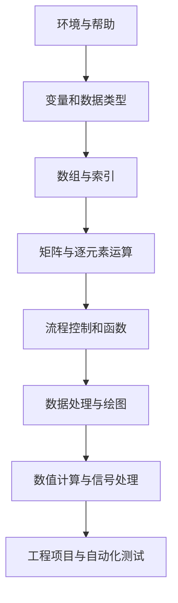
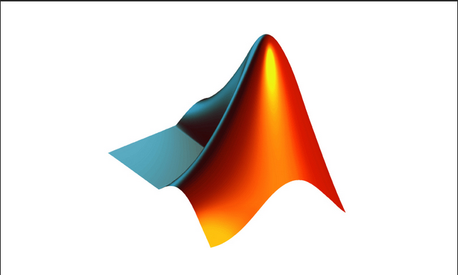
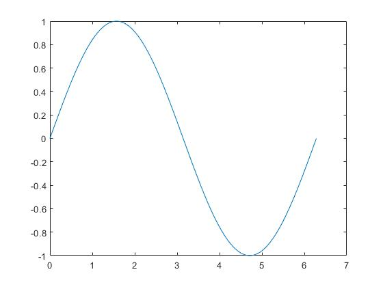

# MATLAB 基础教程

> 本文保留仓库中的原始教程内容，并补充学习导航。原资料部分章节尚未展开，建议结合 [MATLAB 基础 100 问](../Questions/Matlab-Basics-100.md) 与 [学习路线](../StudyPlan.md) 系统练习。

## 学习导航

| 阶段 | 核心内容 | 建议动作 |
|---|---|---|
| 环境与帮助 | 命令窗口、工作区、路径、help/doc | 学会定位函数、检查版本与依赖 |
| 语言基础 | 变量、数据类型、运算符、流程控制 | 每个语法点写一个最小示例 |
| 数组与矩阵 | 索引、矩阵运算、逻辑索引、预分配 | 重点区分矩阵运算与逐元素运算 |
| 函数与调试 | 输入输出、作用域、断点、异常处理 | 把重复逻辑封装为函数并测试 |
| 数据与绘图 | 导入、统计、曲线、子图、图形导出 | 保留原始数据并标注单位 |
| 数值与工程 | 线性方程、FFT、滤波、算法验证 | 使用固定测试向量和误差指标 |

## 推荐学习顺序



## 最小运行练习

将下面代码保存为脚本并运行，确认变量、数组运算和绘图流程都能正常工作：

```matlab
clear; clc; close all;

Fs = 1000;
t = (0:999) / Fs;
x = sin(2*pi*5*t) + 0.1*cos(2*pi*40*t);

figure;
plot(t, x);
grid on;
xlabel('Time (s)');
ylabel('Amplitude');
title('Sample signal');
```

练习要求：
1. 把 5 Hz 与 40 Hz 改成其他频率，观察波形变化。
2. 修改采样率和采样点数，确认时间轴与数据长度一致。
3. 使用 `mean`、`max`、`min` 计算统计量。
4. 为脚本添加输入参数检查，并把信号生成逻辑改写成函数。

## 学习检查

- [ ] 能解释 `A*B` 与 `A.*B` 的区别。
- [ ] 能使用索引和逻辑掩码筛选数组。
- [ ] 能将脚本中的重复逻辑封装成函数。
- [ ] 能导入数据、绘制带单位的图并保存结果。
- [ ] 能为算法设计边界测试并计算误差。
- [ ] 能说明示例依赖的 MATLAB 版本或工具箱。

## 配套资料

- [MATLAB 基础 100 问](../Questions/Matlab-Basics-100.md)：概念、示例、边界条件与工程验证。
- [学习路线与实践计划](../StudyPlan.md)：阶段目标、项目练习和复盘方式。
- [函数参考](../Src/Function.md)：查找已有的常用函数记录。

> Version  MATLAB2018b 



---


# 目录
* [1.MATLAB用户界面](#1.MATLAB用户界面)
* [2.帮助系统](#2.帮助系统)
* [3.MATLAB基础知识](#3.MATLAB基础知识)
* [4.向量与多项式子](#4.向量与多项式子)
* [5.矩阵运算](#5.矩阵运算)
* [6.二维绘图](#6.二维绘图)

---


# 1.MATLAB用户界面

## 1.1 MATLAB中的科学计算概述

> MATLAB是一款功能非常强大的科学计算软件。

# 2.帮助系统


# 3.MATLAB基础知识

## 3.1 MATLAB命令的组成

### 3.1.1 基本符号

### 3.1.2 功能符号


### 3.1.3 常用指令

| 命令    | 功能                   | 命令   | 功能               |
| ------- | ---------------------- | ------ | ------------------ |
| `clf`   | 清除图形窗口信息       | `hold` | 图形保持           |
| `diary` | 日志文件               | `load` | 加载指定文件的变量 |
| `dir`   | 显示当前目录下文件     | `pack` | 显示搜索目录       |
| `disp`  | 显示变量或文字内容     | `quit` | 退出MATLAB         |
| `echo`  | 命令行窗口信息显示开关 | `path` | 显示搜索目录       |
| `save`  | 保存内存变量指定文件   | `type` | 显示文件内容       |


## 3.2 数据类型

### 3.2.1 变量与常量

* 变量
* 常量

| 常量名称  | 说明               |
| --------- | ------------------ |
| `ans`     | MATLAB中的默认变量 |
| `pi`      | 圆周率             |
| `eps`     | 浮点运算的相对精度 |
| `inf`     | 无穷大，比如1/0    |
| `NaN`     | 不定值，如0/0      |
| `i,j`     | 复数中的虚数单位   |
| `realmin` | 最小正浮点数       |
| `realmax` | 最大正浮点数       |


# 4. 向量与多项式子


# 5.矩阵运算

# 6. 二维绘图

## 6.1  线图

* MATLAB函数

  | `plot`  | 二维线图 |
  | ------- | -------- |
  | `plot3` | 三维线图 |
  |         |          |
  |         |          |


```matlab
x = 0:pi/100:2*pi;
y = sin(x);
figure % opens new figure window
plot(x,y)
```



* MATLAB语言语法

* 属性


## 6.2 饼图、条形图

# 7.图形标注

# 8.三维绘图

# 9. 程序设计


