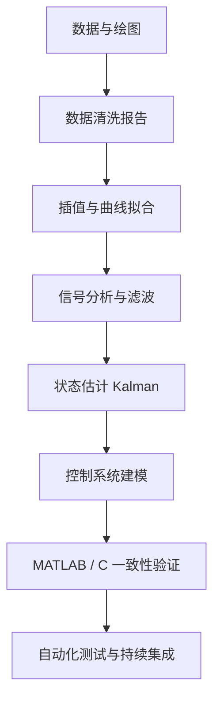
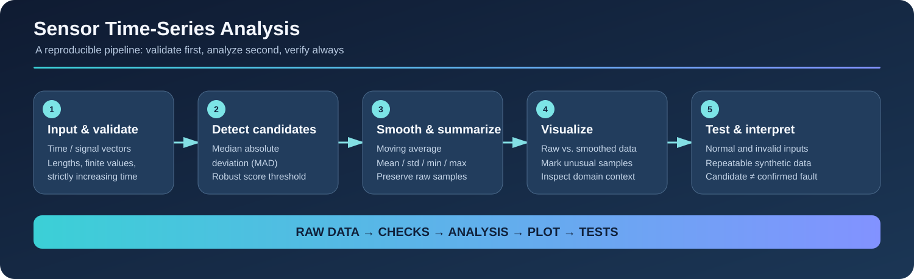

# MATLAB 实战项目路线：从练习到工程作品集

本路线将语法练习升级为可复现项目。每个项目都应包含问题定义、输入数据、实现代码、测试、可视化结果、误差分析和使用说明。工具箱依赖需在项目 README 中明确声明。

## 项目路线图



## 可直接运行的项目入口

### 传感器时序分析（无需外部数据）



- 数据文件：[sensor_sample.csv](../Data/sensor_sample.csv)
- 运行脚本：[sensor_csv_demo.m](../Src/Examples/sensor_csv_demo.m)
- 核心函数：[analyze_sensor_data.m](../Src/Examples/analyze_sensor_data.m)
- 测试：[test_sensor_analysis_project.m](../Tests/test_sensor_analysis_project.m)

从仓库根目录执行 `run('Src/Examples/sensor_csv_demo.m')`。该练习覆盖 CSV 读取、列检查、移动平均、MAD 异常候选标记与结果可视化。示例数据是合成数据，实际项目还应记录传感器量程、单位、采样条件和异常判断依据。

## 项目清单

| 等级 | 项目 | 核心技能 | 验收产物 |
|---|---|---|---|
| 入门 | 传感器数据探索 | 数组、统计、绘图 | 数据概览图、统计摘要 |
| 入门 | CSV 清洗与质量报告 | table、缺失值、异常值 | 清洗前后指标与报告 |
| 入门+ | 多组数据可视化 | tiledlayout、图例、导出 | 统一风格的图表集 |
| 进阶 | 插值算法比较 | interp1、自定义插值、误差 | 不同方法误差曲线 |
| 进阶 | 曲线拟合与模型选择 | 最小二乘、残差分析 | 拟合结果与适用范围 |
| 进阶 | 频谱分析工具 | FFT、窗函数、频率轴 | 时域/频域分析报告 |
| 进阶 | 一阶滤波器设计 | 差分方程、截止频率、延迟 | 阶跃与含噪信号对比 |
| 高级 | 位置—速度 Kalman 滤波 | 状态空间、协方差 | 估计误差与参数实验 |
| 高级 | 控制系统阶跃响应分析 | 传递函数、稳定性指标 | 响应曲线与指标表 |
| 工程 | MATLAB 与 C 参考实现比对 | CSV、容差、回归测试 | 差异报告和自动化测试 |
| 工程 | 定点量化误差评估 | 位宽、缩放、饱和 | 量化误差预算 |
| 工程 | 可复现算法验证包 | 测试、版本记录、CI | 一键运行的完整项目 |

## 项目模板

```text
project-name/
├── README.md          # 问题、运行方式、依赖、验收标准
├── data/              # 小型样例数据或数据生成器
├── src/               # 算法实现
├── tests/             # 正常、边界、异常与回归测试
├── results/           # 运行生成的图表和指标
└── docs/              # 数学推导、设计决定与限制
```

## 统一验收标准

- [ ] 在干净工作区中按 README 步骤运行成功。
- [ ] 明确 MATLAB 版本、工具箱与外部依赖。
- [ ] 输入、输出、单位、维度和参数含义有文档。
- [ ] 至少包含正常值、边界值和异常输入测试。
- [ ] 数值结果有独立参考、解析结果或误差指标验证。
- [ ] 图表包含标题、轴标签、单位和必要图例。
- [ ] 结果可重复生成，不依赖手工工作区变量。
- [ ] 记录已知限制和下一步改进方向。

## 面向嵌入式算法开发的附加要求

对准备移植到 C / MCU 的算法，额外记录：

1. 数值类型（single/double/定点）及其范围。
2. 采样周期、单位、初始状态和状态更新顺序。
3. 溢出、舍入、饱和、NaN/Inf 的处理策略。
4. MATLAB 与目标实现的输入向量和输出对比。
5. 绝对误差、相对误差、最大误差及允许容差。
6. 编译器、目标平台和测试数据版本。

## 推荐资源

- [MATLAB 文档](https://www.mathworks.com/help/matlab/)
- [MATLAB 示例](https://www.mathworks.com/help/matlab/examples.html)
- [Simulink 文档](https://www.mathworks.com/help/simulink/)
- [MATLAB Answers](https://www.mathworks.com/matlabcentral/answers/)