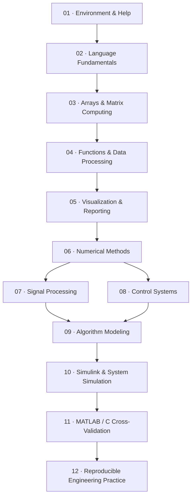
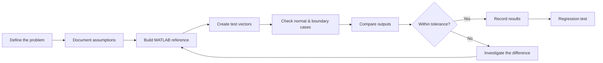

<!--
  MATLAB Learning & Engineering Practice
  A structured, hands-on repository for numerical computing and algorithm validation.
-->

<div align="center">

# MATLAB · Learning & Engineering Lab

**From mathematical fundamentals to reproducible experiments and engineering-grade algorithm validation.**

[](https://www.mathworks.com/products/matlab.html)
[](StudyPlan.md)
[](Src/Examples/README.md)
[](https://mermaid.js.org/)

<br/>


*Learn the language. Understand the mathematics. Validate the algorithm. Make the result reproducible.*

</div>

---

## Overview

This repository is a structured learning and practice space for **MATLAB programming, scientific computing, data analysis, signal processing, control-system exploration, and embedded-algorithm verification**.

It combines progressive learning notes, a staged study plan, a question-driven knowledge base, reusable examples, and engineering-oriented validation exercises. The aim is not merely to collect syntax, but to build a workflow that moves from understanding a concept to implementing it, testing it, and explaining its limitations.

> **Learning principle:** Every important concept should lead to an experiment; every algorithm should have explicit assumptions, boundary conditions, and a way to verify its results.

## Start Here

| If you want to… | Start with | What you will find |
|---|---|---|
| Plan a complete learning journey | [Study Plan](StudyPlan.md) | Stages, weekly practice, checkpoints, and projects |
| Learn MATLAB fundamentals | [MATLAB Tutorial](Doc/Matlab.md) | Environment, syntax, arrays, matrices, and plotting |
| Practice through focused questions | [MATLAB Basics — 100 Questions](Questions/Matlab-Basics-100.md) | Topic-based questions, explanations, and examples |
| Run and inspect practical code | [Examples & Tests](Src/Examples/README.md) | Filtering, interpolation, Kalman filtering, FFT, quantization, and MATLAB/C comparisons |
| Look up commonly used functions | [Function Reference](Src/Function.md) | A practical function index |
| Explore recommended reading | [Books](Books/Books.txt) | Books and further learning resources |
| Study native-code integration and debugging | [GDB / MEX Notes](Src/Program/gcc/gdb.md) | Related notes for debugging and native-code workflows |

## Learning Architecture

The repository is organized around a progression from fundamentals to applied engineering. Follow the full route, or jump into an individual topic when you need a targeted reference.



### Core Knowledge Areas

<div align="center">

| Fundamentals | Modeling & Analysis | Engineering Practice |
|:---:|:---:|:---:|
| Syntax, arrays, matrices | Numerical computation | Testable examples |
| Functions, scripts, data types | Filtering and FFT | Boundary-condition checks |
| Plotting and visualization | Interpolation and Kalman filters | MATLAB/C comparison |
| Tables, files, and data handling | Control-system exploration | Reproducible results |

</div>

## Practical Workbench

The [examples directory](Src/Examples/README.md) is the recommended starting point for hands-on practice.

| Topic | Practice focus |
|---|---|
| Arrays and statistics | Data construction, indexing, and summary operations |
| Low-pass filtering | Signal smoothing and response inspection |
| Linear interpolation | Interpolation behavior and input constraints |
| Kalman filtering | One-dimensional and position–velocity estimation |
| Sensor data and FFT | Outlier inspection and frequency-domain analysis |
| Fixed-point quantization | Quantization error and numerical representation |
| MATLAB / C comparison | Reference behavior, output comparison, and regression checks |

### A Typical Algorithm-Validation Workflow



For embedded or performance-sensitive algorithms, MATLAB can serve as a readable reference model before comparing a C implementation. Define numeric precision, units, initial conditions, saturation behavior, and tolerances explicitly; matching plots alone is not sufficient evidence of equivalence.

## Recommended Study Method

1. **Understand** — Read the concept and identify the mathematical or programming principle.
2. **Implement** — Write a small example that can be run independently.
3. **Visualize** — Plot intermediate and final results to make behavior observable.
4. **Challenge** — Test empty inputs, boundary values, unexpected dimensions, and noisy data where applicable.
5. **Compare** — Validate against a known result, a reference implementation, or a documented expectation.
6. **Record** — Keep the assumptions, execution steps, expected output, and conclusions with the code.

## Quick Start

1. Install MATLAB, or use an available MATLAB environment compatible with the examples.
2. Clone or download this repository.
3. Open the repository in MATLAB and navigate to the relevant example directory.
4. Read the example's instructions before running it; check any toolbox or version requirements.
5. Run the script or function and compare the result with the documented expectation.

```bash
git clone https://github.com/ilikui/Matlab.git
cd Matlab
```

Start with [the examples guide](Src/Examples/README.md) for the most direct route to executable practice.

> **Compatibility note:** Some legacy notes may target MATLAB R2018b or depend on specific toolboxes. The installed MATLAB release and its official documentation take precedence. Check each example's requirements before execution.

## Repository Map

```text
Matlab/
├── README.md                 # Project overview and navigation
├── StudyPlan.md              # Structured learning roadmap
├── Doc/                      # Tutorials and conceptual notes
├── Questions/                # Question-driven practice
├── Src/
│   ├── Examples/             # Runnable examples and validation exercises
│   ├── Function.md           # Function reference
│   └── Program/              # Native-code and debugging notes
├── Books/                    # Recommended reading
└── Imge/                     # Learning and documentation images
```

The tree above highlights the main entry points; consult the repository directories for the complete and current file list.

## Official Resources

- [MATLAB Documentation](https://www.mathworks.com/help/matlab/)
- [Get Started with MATLAB](https://www.mathworks.com/help/matlab/getting-started-with-matlab.html)
- [Simulink Documentation](https://www.mathworks.com/help/simulink/)
- [MATLAB Examples](https://www.mathworks.com/help/matlab/examples.html)
- [MATLAB Answers](https://www.mathworks.com/matlabcentral/answers/)

## Contributing & Continuous Improvement

Learning material is most useful when it is clear, testable, and maintainable. Improvements are welcome in the form of corrected explanations, runnable examples, better visualizations, additional exercises, and reproducible validation cases.

When adding an example, aim to include:

- **Purpose:** the problem the example demonstrates.
- **Requirements:** MATLAB release and toolbox dependencies, if any.
- **Inputs and outputs:** expected shapes, units, and data types.
- **Execution:** clear steps to run the example.
- **Validation:** expected behavior, tolerances, and edge cases.
- **Limitations:** assumptions and known constraints.

## License

See [LICENSE](LICENSE) for the license terms applicable to this repository.

---

<div align="center">

**Understand the math. Write the model. Verify the result.**

*An evolving, practical reference for MATLAB learning and engineering exploration.*

</div>
