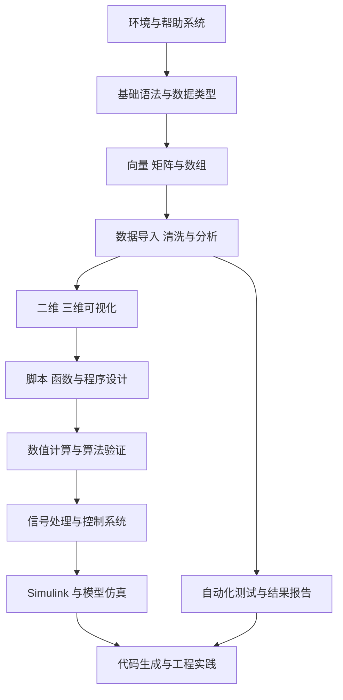

# MATLAB 学习路线与实践计划

> 目标：把 MATLAB 从“能看懂语法”提升到“能用脚本分析数据、建立模型、验证算法，并服务于控制系统、信号处理和嵌入式开发”。  
> 建议节奏：每周 4–5 次，每次 45–90 分钟；按阶段完成任务，不以看完教程为完成标准。  
> 版本说明：仓库原有资料标注 MATLAB R2018b。学习时优先使用当前安装版本；遇到版本差异时记录差异，不要把旧版本命令当成唯一写法。

## 学习路线图



## 阶段总览

| 阶段 | 学习主题 | 必须完成的产出 | 自测标准 |
|---|---|---|---|
| 0 | 环境、界面、帮助、路径 | 环境检查脚本与学习记录 | 能使用 `help`、`doc`、`which`、`ver` 定位问题 |
| 1 | 变量、运算符、数据类型、逻辑索引 | 基础语法练习集 | 能解释数值、字符、字符串、逻辑值、结构体、元胞数组 |
| 2 | 向量、矩阵、数组与线性代数 | 矩阵运算示例 | 能区分矩阵乘法 `*` 与逐元素运算 `.*` |
| 3 | 脚本、函数、作用域、错误处理 | 可复用函数库 | 函数有输入输出、边界检查和示例 |
| 4 | 文件读写、表格数据、缺失值与统计 | 数据分析小报告 | 原始数据、处理步骤和结果可复现 |
| 5 | 二维/三维绘图与可视化 | 图表集 | 图有标题、坐标轴、单位、图例，能导出图片 |
| 6 | 数值计算、插值、拟合、优化 | 算法对比实验 | 说明假设、误差来源与适用条件 |
| 7 | 信号处理与控制基础 | 滤波/系统响应实验 | 能绘制时域、频域或阶跃响应并解释结果 |
| 8 | Simulink、模型验证与代码生成 | 简单闭环模型或算法原型 | 模型输入输出明确，有测试用例和结果记录 |
| 9 | 工程化实践 | 完整项目、README、测试脚本 | 一键运行、结果可复现、异常可诊断 |

## 每周执行方法

1. **理解**：阅读对应章节，整理概念和易错点。
2. **复现**：手动输入示例，避免只复制粘贴。
3. **变式**：修改输入范围、数据规模和边界条件。
4. **验证**：与解析结果、理论公式或另一种实现交叉核对。
5. **沉淀**：将可复用结论写成短笔记；把代码、输入数据和输出图一起归档。

每个主题使用以下完成清单：

- [ ] 能用自己的话解释核心概念
- [ ] 完成至少 3 个基础练习
- [ ] 完成 1 个带边界条件的变式
- [ ] 检查维度、单位、NaN/Inf、空输入等情况
- [ ] 保存可运行代码和结果截图/图表
- [ ] 记录一个错误案例及其原因

## 详细章节

### 阶段 0：环境与帮助系统

- 命令窗口、工作区、当前文件夹、编辑器、图窗。
- 使用 `help functionName`、`doc functionName`、`lookfor keyword`。
- 使用 `pwd`、`cd`、`dir`、`which`、`path`、`ver`。
- 理解当前目录与 MATLAB 搜索路径的区别。
- 练习：写一个环境信息脚本，输出版本、当前目录和所需工具箱状态。

### 阶段 1：语言基础

- 变量命名、数值类型、复数、逻辑值、字符与字符串。
- 运算符优先级、关系运算、逻辑运算、短路逻辑。
- 冒号表达式、索引、切片、逻辑索引。
- `if/elseif/else`、`switch`、`for`、`while`。
- 常见陷阱：数组从 1 开始索引；浮点数比较；行向量与列向量方向；隐式扩展的版本差异。

练习：统计一组传感器数据的最大值、最小值、均值、超限点及其索引。

### 阶段 2：向量、矩阵与数组

- 创建数组：`[]`、`zeros`、`ones`、`eye`、`linspace`、`reshape`。
- 索引与维度：`size`、`length`、`numel`、`ndims`。
- 矩阵运算：转置、乘法、线性方程组、秩、行列式、特征值。
- 逐元素运算：`.*`、`./`、`.^`。
- 组织数据：元胞数组、结构体、表格；按实际数据语义选择容器。

练习：求解线性方程组 `A*x=b`，比较反斜杠运算符 `A\\b` 与显式求逆的数值稳定性和可读性。

### 阶段 3：脚本与函数

- 脚本与函数的职责差异；输入参数、输出参数和局部变量。
- 匿名函数、函数句柄、局部函数。
- `nargin`、`nargout`、`varargin` 的适用场景。
- 输入验证、错误提示、断言、异常处理。
- 代码拆分、命名、注释、单元测试基础。

练习：编写一个带输入范围检查的线性插值函数，测试正常输入、边界输入、重复采样点和非法输入。

### 阶段 4：数据导入、处理与分析

- 文本、CSV、Excel、MAT 文件的读写。
- 清洗缺失值、重复记录、异常值；保留原始数据。
- 描述性统计、分组分析、时间序列处理。
- 将数据处理过程封装为可重复运行的脚本或函数。

练习：导入一组传感器日志，完成清洗、统计、趋势图和结果导出。

### 阶段 5：可视化

- `plot`、`scatter`、`bar`、`histogram`、`tiledlayout`、`subplot`。
- `xlabel`、`ylabel`、`title`、`legend`、`grid`、坐标轴范围。
- 三维曲线、曲面和等高线。
- 图形导出、单位标注、颜色与线型的可读性。

练习：同一份数据分别绘制原始信号、滤波信号和误差曲线，保证坐标和单位一致。

### 阶段 6：数值方法与算法

- 插值、曲线拟合、数值积分与微分。
- 求根、优化、线性方程组与数值误差。
- 随机数、重复试验、固定随机种子以便复现。
- 复杂度、精度、稳定性和边界条件。

练习：对同一数据比较线性插值与多项式拟合，解释过拟合和外推风险。

### 阶段 7：面向工程的信号处理与控制

- 采样率、采样周期、混叠、噪声与滤波。
- 均值滤波、低通滤波、频谱分析与 FFT。
- 传递函数、状态空间、阶跃响应、频率响应和 PID 基础。
- 用仿真数据验证算法，说明初始条件、采样时间和单位。

练习：构造含噪传感器信号，对比移动平均与一阶低通滤波的响应延迟和噪声抑制效果。

### 阶段 8：Simulink 与模型化开发

- 模块、信号、采样时间、求解器和模型参数。
- 子系统、参数化模型、模型测试与结果记录。
- MATLAB 脚本驱动仿真；理解连续与离散系统的差别。
- 根据实际需求再学习 Stateflow、Simulink Test 等工具。

练习：建立一个简单离散控制模型，改变采样时间与参数，比较输出并保存实验配置。

### 阶段 9：工程化与代码生成

- 代码组织、配置参数、日志、自动化测试。
- MATLAB 与 C/C++ 的数据类型、数组布局、数值精度差异。
- MATLAB Coder / Simulink Coder 的适用范围、约束和生成代码检查。
- 生成代码必须经过编译、测试和目标平台验证，不能只以仿真成功作为依据。

练习：选取一个不依赖工具箱的简单算法，编写 MATLAB 参考实现和 C 版本，用固定测试向量对比输出与误差。

## 项目练习（从易到难）

1. **数据可视化工具**：导入 CSV，选择列，显示统计值并导出图表。
2. **传感器数据清洗**：处理缺失值、异常值、单位换算并生成报告。
3. **查表与插值**：实现一维/二维查表，验证边界策略和精度。
4. **数字滤波实验台**：可切换滤波算法，比较噪声抑制与延迟。
5. **控制系统分析**：分析阶跃响应、稳态误差和参数变化。
6. **算法跨语言验证**：MATLAB 作为参考模型，与 C 实现对比。
7. **可复现工程项目**：提供 README、示例数据、运行入口、测试和结果图。

## 目录建议

```text
Matlab/
├── README.md
├── StudyPlan.md
├── Doc/
│   └── Matlab.md
├── Examples/
│   ├── Basics/
│   ├── Matrix/
│   ├── Visualization/
│   ├── DataAnalysis/
│   ├── SignalProcessing/
│   └── Control/
├── Projects/
│   ├── SensorDataAnalysis/
│   ├── LookupInterpolation/
│   └── FilterWorkbench/
├── Tests/
└── Books/
```

> 目录是建议结构。新增内容时先检查现有目录，尽量复用已有资料，不要为了符合模板而重复搬运文件。

## 复盘模板

每次学习结束后记录：

- **本次主题**：
- **关键概念**：
- **能解决的问题**：
- **最小可运行示例**：
- **易错点 / 边界条件**：
- **验证方法与结果**：
- **仍未理解的问题**：
- **下一步练习**：

## 官方资料

- [MATLAB 产品页](https://www.mathworks.com/products/matlab.html)
- [MATLAB 文档](https://www.mathworks.com/help/matlab/)
- [MATLAB 入门教程](https://www.mathworks.com/help/matlab/getting-started-with-matlab.html)
- [Simulink 文档](https://www.mathworks.com/help/simulink/)
- [MATLAB 示例](https://www.mathworks.com/help/matlab/examples.html)


## 可运行示例与算法验证

完成基础语法后，进入 [可运行示例目录](Src/Examples/README.md)，建议按以下顺序操作：

1. `basic_arrays.m`：数组创建、逻辑索引、统计量、超限检测和绘图。
2. `linear_interp_checked.m`：检查查表输入、单调性、边界策略与插值结果。
3. `lowpass_filter.m`：观察离散递推滤波系数对平滑程度和响应速度的影响。
4. `kalman_1d.m`：理解预测、测量更新、Kalman 增益和协方差递推。
5. `run_tests.m`：运行回归测试，并为每次代码修改增加边界测试。

运行方式（从仓库根目录执行）：

```matlab
addpath(fullfile(pwd, 'Src', 'Examples'));
run('Src/Examples/basic_arrays.m');
run('Src/Examples/run_tests.m');
```

### 算法验证的最低要求

- 固定测试输入，记录预期输出；对浮点结果使用合理容差。
- 覆盖正常值、边界值、空输入、异常输入和尺寸错误。
- 记录单位、采样周期、初始状态、参数含义与模型假设。
- 将 MATLAB 参考结果与独立计算、理论结果或 C 实现交叉比较。
- 示例通过测试不等于可直接用于量产项目；需要按目标系统补充需求、故障处理和目标平台验证。

